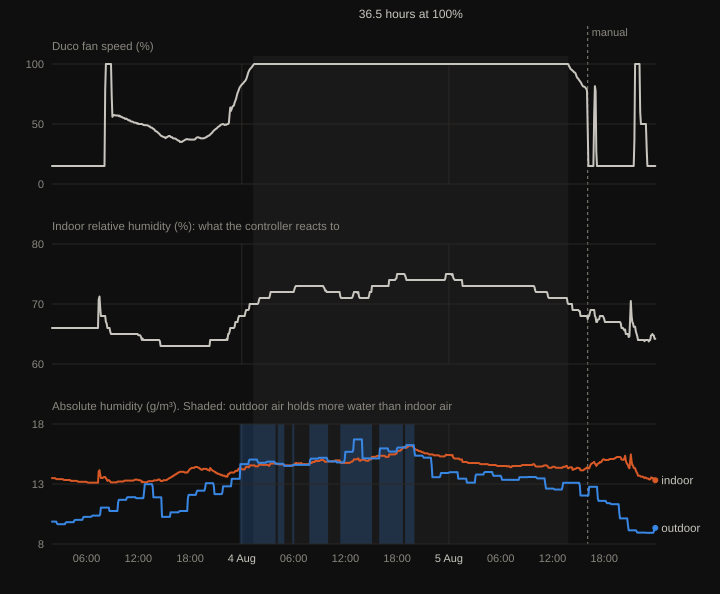
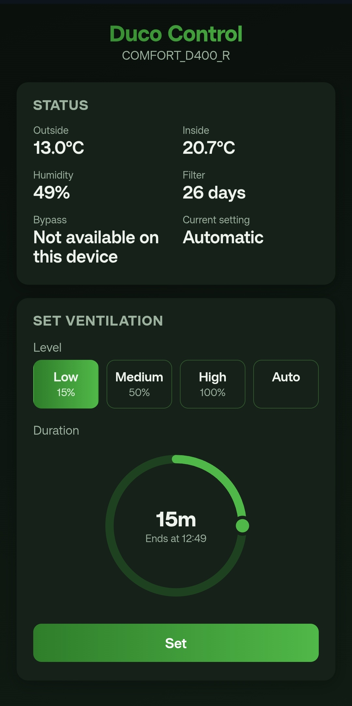

Our house has a NIBE heat pump, a Huawei solar inverter, a Duco
ventilation unit and a HomeWizard P1 meter on the grid connection. Each
one ships with its own app, its own cloud and its own idea of what a data
point is. None of them know the others exist.

That is fine if all you want is a dashboard per device. It is not fine if
you want to ask questions that cross device boundaries: how much of the
heat pump's consumption is covered by solar, how the house responds to
outdoor temperature, what the ventilation does to indoor comfort. Those
questions need all the data in one place, on one time axis.

I didn't know yet which of those questions would turn out to matter. So
the first goal was not analysis. It was collection: get everything every
device exposes into one database, and decide later what to do with it.
The first thing it turned up was a
ventilation unit that ran at full speed for 36 hours and left the house
exactly as humid as it found it.

## The problem: every device speaks a different language

| Source | What it measures | Protocol | Cadence |
|---|---|---|---|
| NIBE heat pump | Temperatures, compressor, power | HTTPS REST, Basic auth | 60 s |
| HomeWizard P1 | Grid import/export | HTTP REST, no auth | 60 s |
| Duco ventilation | Airflow, humidity, air temperatures | HTTP REST, two endpoints | 60 s |
| Huawei SUN2000 | PV production, inverter state | Modbus TCP | 60 s |
| Proxmox host | CPU temps, SMART, storage | Custom HTTP endpoint | 60 s |
| Open-Meteo | Outdoor weather (model) | Public HTTPS API | 15 min |
| MeteoBelgie | Outdoor weather (station) | HTML scrape | 1 h |

The Modbus source is the odd one out:
there is no "give me everything" call, only numbered registers you have
to request one by one. The scraped source is the fragile one: its schema is whatever the
page's HTML happens to be today.

On top of the device sources, the collector also polls a small endpoint on
the Proxmox host it runs on, so I can tell whether a gap in the data comes
from a device or from my own infrastructure.

## Architecture

The core is a single long-running Python daemon, `collector.py`, running
as a systemd service in an LXC container on Proxmox. It has been running
since the end of July 2026 and writes around 13,000 series. The code,
including the downsampling task and tests, is
[on GitHub](https://github.com/GWVG/home-energy-collector). Each cycle it:

1. Takes one UTC timestamp.
2. Fetches every local source, each in its own `try/except`.
3. Reuses the cached response for the weather sources unless their own,
   longer interval has elapsed.
4. Flattens the raw responses into InfluxDB points.
5. Writes everything in a single synchronous call, or nothing if every
   source failed.
6. Waits until 60 seconds after the cycle started, and repeats.

Anything that analyses the data runs as a separate job that only reads
from the database. The collector doesn't know those jobs exist, so
experimenting on the analysis side can never break collection.

## Design decisions

### 1. One timestamp per cycle, not per source

Every device point written in a cycle carries the same timestamp, taken once at
the start of the cycle, rather than the time each individual fetch
returned.

This makes cross-device questions trivial. Heat pump power, solar
production and grid import from the same minute share an exact
timestamp, so they line up in a query without resampling or
nearest-neighbour joins.

The cost is precision: a source fetched later in the cycle is stamped
early, the inverter by up to ten seconds, because Modbus reads registers
one request at a time. That doesn't matter here. The questions this data
answers are about trends over days, weeks and seasons. Nothing in a
house changes meaningfully in ten seconds.

The weather sources are the exception. The collector writes every minute
but fetches weather far less often, so between fetches it writes the
cached reading again, under the source's own observation time: the start
of Open-Meteo's model interval, and the time printed on the station
page. Every rewrite lands on the same point, so each observation is
stored once. Lining weather up with the device data
happens at query time, by carrying the last reading forward. That is why
the outdoor line in the chart further down moves in hourly steps.

### 2. Store everything, except where I knew what I wanted

The device responses are not mapped field by field. One recursive
function, `to_points()`, walks whatever JSON a device returns and flattens
it into InfluxDB points. No NIBE, HomeWizard or Duco field name is
hardcoded. The Huawei inverter goes through the same function, after a
curated list of Modbus registers is read and a small step converts values
`to_points()` can't handle (datetimes, lists of strings).

Two reasons. The devices expose a lot of fields, too many to map by hand
and keep in sync with firmware updates. And at the start I didn't know
which fields would be useful. Choosing a subset up front means guessing,
and a field you didn't store is a field you can't analyse later. Storage
is cheap; missing history can't be recovered.

The two weather sources are the exception: hand-built points with field
names I chose, because I added them for a specific gap. None of the
devices measure outdoor humidity. They are also deliberately two kinds
of data: Open-Meteo is model output, MeteoBelgie a nearby station. Side
by side, they show how well the forecast matches what actually happened
locally, which matters as soon as anything acts on a forecast.

### 3. Downsample late, in small slices

Storing everything is cheap, not free. Raw data is kept for 90 days.
Every 15 minutes, an InfluxDB task takes the 15-minute slice that has
just turned seven days old and writes its mean to a second bucket for the
long term. The gap between day 7 and day 90 is deliberate: if the task
ever stalls, there are 83 days to notice and backfill. That margin only
helps if you use it. The long-term bucket starts on 7 August, a week after
the database went up. That first week was never backfilled, and by early
November it had aged out of the raw bucket. The chart further down comes
from that week: I exported it a few days before it expired. The small
slices keep memory flat: one run over a full day means aggregating around
13,000 series at once, which fills the swap of the 2 GB container.

The long-term bucket is where "store everything" stops being literal.
Only numeric fields are downsampled, because `mean()` fails on strings
and booleans. The task selects them by type, not by name, so a new
numeric field from a firmware update is picked up without touching the
task, and a new string field is skipped instead of crashing it. Status
strings and validation flags stay in the raw bucket and age out with it.

### 4. Fail per source, recover instead of buffer

Each source fails independently: a dead inverter does not stop the heat
pump from being recorded, and an error never gets written into the
database as fake data. But if InfluxDB itself is down, that cycle's data
is logged and dropped. There is no disk queue, no retry.

The database runs on the same host as the collector, and outages have
been rare. Over the last 90 days the grid meter series has six gaps
longer than two minutes, about 12.6 hours in total, or 99.4% coverage.
When one happens, the result is a gap in a time series that's
used for long-term trends, and a gap of a few minutes or hours doesn't
change a trend. A durable buffer would add state, disk management and
replay logic to protect data that isn't worth protecting yet.

What matters more than not losing a minute is not losing a week. After a
power cut, the server, the container, the database and the collector all
come back up on their own, and an external heartbeat mails me when the
host goes quiet. An outage costs the time the system was down, not the
time until I notice.

That calculation changes the moment the data drives control decisions
instead of analysis. Then a gap isn't a missing point on a chart, it's a
decision made on stale input.

## What the data showed

The Duco unit runs in automatic mode by default: when indoor relative
humidity rises, it ramps up the airflow. In summer it would climb to full
speed on humid days and stay there. Summer is also when the heat pump
cools the house passively through the floor, which keeps it at around
23 °C inside even during a heatwave. In early August the fan ran at 100% for
36.5 hours straight, from 01:20 on 4 August to 13:50 the next day.

Indoor relative humidity was 70% when the fan reached 100%. It rose to
75% in the evening, as the house warmed from 23 to 24 °C, and was back
at 70% when the fan came down.

The reason is physics. What matters for drying a house is not relative
humidity but absolute humidity: the actual amount of water in the air.
Ventilation swaps indoor air for outdoor air, so at best it brings the
house to the outdoor water content. That night the outdoor air was 20 °C
at 85% relative humidity. At the 23 °C inside, the same air is at about 71%.
The house was already there: indoors and outdoors, the dew point was
around 17.5 °C. The next afternoon it was worse: 32 °C at 50% outside
is about 85% at 23 °C, a dew point of 20 °C against 18 °C
inside. For 13 of the 36.5 hours the outdoor air
held more water than the indoor air, and indoor absolute humidity rose
from 14.6 to a peak of 16.2 g/m³ while the fan ran flat out to bring it down.

The controller can't tell "the house is humid" from "the weather is
humid". Automatic mode works off a humidity sensor in the extract duct,
just before the air enters the unit. The only thing it measures outside
is temperature.

None of the devices could have shown this on its own. It took indoor
humidity from the Duco, indoor temperature from the heat pump and outdoor
conditions from a weather station, on one time axis. That is what the
collector is for.

## What I've built on top

**A local Duco app.** Until something smarter exists, the fix is manual:
open the Duco app and turn the fan down. Except the app doesn't talk to
the unit in my attic. It talks to Duco's servers, which then talk to the
unit in my attic. Sometimes slowly, sometimes not at all, and then the
fallback is climbing to the attic during a heatwave to press a button, to
stop a machine from making the house more humid.

So I wrote [an app](https://github.com/GWVG/duco-control) that talks to the unit's local API directly. Same
controls, instant response, and the traffic never leaves the house. The
attic is once again a place I visit voluntarily.

## What's next

**Replacing the Duco automatic mode.** The humidity behaviour above is
the first concrete case where the data points to a better control rule:
only increase ventilation for humidity when the outdoor air is actually
drier than the indoor air. Everything that rule needs is already in the
database, so before it controls anything I can replay it on 4 and 5
August and compare its fan hours with what automatic mode did. What a
replay can't show is how the house would have responded to a different
fan setting. That needs a model of the house's humidity, fitted on the
same data, and that is where this stops being a dashboard problem.

**Further out.** With weather, solar production and consumption on one
time axis, there are obvious bigger targets: forecasting tomorrow's solar
surplus, and using the heat pump's SG Ready input to store that surplus
as heat instead of exporting it to the grid. That's a larger step, and
one where the forecast-versus-station comparison and the "recover instead
of buffer" decision above will need revisiting.

The first goal was collecting everything without knowing what it would
be for. The ventilation case is the first answer to that question.

The collector is open source:
[GWVG/home-energy-collector](https://github.com/GWVG/home-energy-collector).
