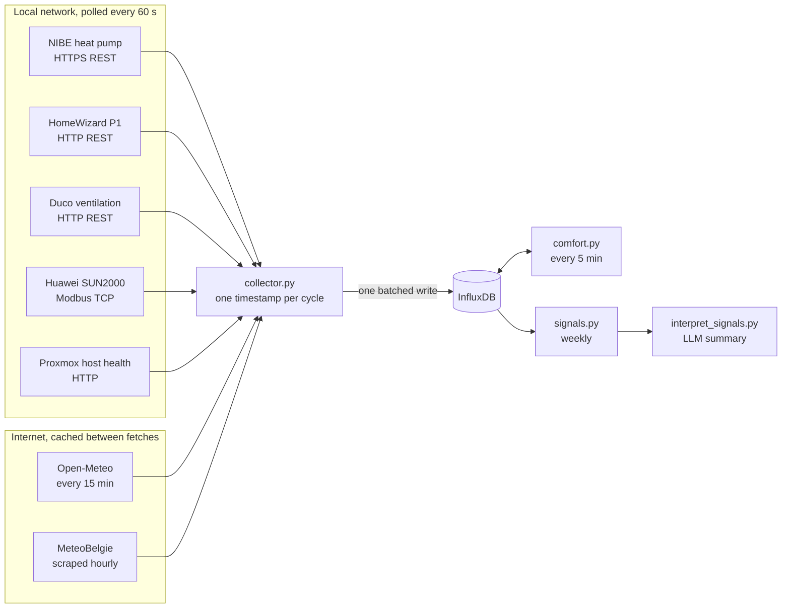

Our house has a NIBE heat pump, a Huawei solar inverter, a HomeWizard P1
meter on the grid connection and a Duco ventilation unit. Each one ships
with its own app, its own cloud and its own idea of what a data point is.
None of them know the others exist.

That is fine if all you want is a dashboard per device. It is not fine if
you want to ask questions that cross device boundaries: how much of the
heat pump's consumption is covered by solar, how the house responds to
outdoor temperature, what the ventilation does to indoor comfort. Those
questions need all the data in one place, on one time axis.

So I wrote a collector.

## The problem: every device speaks a different language

| Source | What it measures | Protocol | Cadence |
|---|---|---|---|
| NIBE heat pump | Temperatures, compressor, power | HTTPS REST, Basic auth | 60 s |
| HomeWizard P1 | Grid import/export | HTTP REST, no auth | 60 s |
| Duco ventilation | Airflow, CO2, humidity | HTTP REST, two endpoints | 60 s |
| Huawei SUN2000 | PV production, inverter state | Modbus TCP | 60 s |
| Proxmox host | CPU temps, SMART, storage | Custom HTTP endpoint | 60 s |
| Open-Meteo | Outdoor weather | Public HTTPS API | 15 min |
| MeteoBelgie | Local weather station | HTML scrape | 1 h |

Three REST APIs with different auth, a binary industrial protocol, a
public API and a scraped web page. The Modbus source is the odd one out:
there is no "give me everything" call, only registers you have to ask for
by name. The scraped source is the fragile one: its schema is whatever the
page's HTML happens to be today.

On top of the device sources, the collector also polls a small endpoint on
the Proxmox host it runs on, so I can tell whether a gap in the data comes
from a device or from my own infrastructure.

## Architecture

The core is a single long-running Python daemon, `collector.py`, running
as a systemd service in an LXC container on Proxmox. Each cycle it:

1. Takes one UTC timestamp.
2. Fetches every local source, each in its own `try/except`.
3. Reuses the cached response for the weather sources unless their own,
   longer interval has elapsed.
4. Converts the raw JSON into InfluxDB points.
5. Writes everything in a single synchronous call, or nothing if every
   source failed.
6. Sleeps 60 seconds and repeats.

Everything downstream is a separate batch job reading from the same
bucket with its own narrowly scoped token: a comfort calculation every
five minutes, a weekly signal-extraction job, and an LLM step that turns
those signals into a readable report. None of them feed back into the
collector. If one breaks, collection keeps running.

## Design decisions

### 1. One timestamp per cycle, not per source

Every point written in a cycle carries the same timestamp, taken once at
the start of the cycle, rather than the time each individual fetch
returned.

> **TODO (GW): why.** What problem does this solve for analysis? What do you
> give up (the true fetch time is a few hundred ms off for later sources)
> and why is that acceptable?

### 2. A generic schema mapper, with deliberate exceptions

The device responses are not mapped field by field. One recursive
function, `to_points()`, walks whatever JSON a device returns and turns it
into InfluxDB points. No NIBE, HomeWizard or Duco field name is hardcoded.
The Huawei inverter goes through the same function, after a curated list
of Modbus registers is read and a small step converts values `to_points()`
can't handle (datetimes, lists of strings).

The two weather sources are the exception: their points are built by
hand, with field names I chose.

> **TODO (GW): why.** Why generic for devices (firmware updates adding
> fields? less code to maintain?) and why hand-curated for weather? What does
> a generic mapper cost you on the InfluxDB side (field explosion, type
> conflicts)?

### 3. Fail per source, never buffer

Each source fails independently: a dead inverter does not stop the heat
pump from being recorded, and an error never gets written into the
database as fake data. But if InfluxDB itself is down, that cycle's data
is logged and dropped. There is no disk queue, no retry.

> **TODO (GW): why.** Why accept data loss during a database outage instead
> of adding a local buffer? What is the actual failure rate you've seen, and
> what would a buffer add in complexity?

## What the data showed

> **TODO (GW): the finding.** One concrete observation, the chart that shows
> it, and what it means for how the house is run.

<!--
Image convention: put the chart in src/assets/images/blog/home-energy-collector/
and reference it relatively. The alt text becomes the caption:

-->

## What's next

The collector answers "what happened". The next two steps are about
"what will happen" and "what should happen".

**Forecasting.** With weather, production and consumption on one time
axis, the obvious next model predicts tomorrow's solar surplus and heat
demand from the weather forecast.

> **TODO (GW):** horizon, target variable, first baseline you plan to beat.

**SG Ready control.** The NIBE heat pump supports SG Ready, a standard
interface where two contacts select one of four operating modes: blocked,
normal, recommended on, forced on. Switching to "recommended on" when a
solar surplus is forecast lets the heat pump store that surplus as heat
in the buffer tank and the house, instead of exporting it to the grid.

> **TODO (GW):** how you'll drive the contacts, and what safeguards keep a
> bad forecast from making the house cold.

That closes the loop: collect, forecast, act, and measure whether acting
helped, using the same collector.
